<!-- ============================================================
     GitHub Profile README — Sandeep Raj (@sandeepraj25)
     Palette: navy #0A192F · blue #3B82F6 · cyan #22D3EE · purple #8B5CF6
     Search for "TODO" to find everything you still need to fill in.
     ============================================================ -->

 

  
  
  
  

## About Me

I'm **Sandeep**, a B.Tech Computer Science & Engineering student (graduating **2028**) who enjoys turning problems into clean, working code.

- **Studying** Computer Science & Engineering, with a focus on core CS fundamentals
- **Interested in** Software Development, Backend Engineering and Data Analytics
- **Practicing** Data Structures & Algorithms in C++ — **500+ problems** solved across LeetCode and GeeksforGeeks
- **Learning** backend development and how databases are designed and queried
- **Exploring** SQL and data analytics to understand how data drives decisions
- **Building** practical projects to apply what I learn
- **Open to** internships and fresher opportunities

## Tech Stack

<table>
  <tr>
    <td width="170"><b>Comfortable with</b></td>
    <td>
      
      <!-- TODO: add confirmed tools here, e.g. git,github,vscode → https://skillicons.dev/icons?i=cpp,git,github,vscode&theme=dark -->
    </td>
  </tr>
  <tr>
    <td><b>Currently learning</b></td>
    <td>
      
      
      
      
      <!-- TODO: swap these for specific tools once confirmed, e.g. mysql,postgres,nodejs,express,python -->
    </td>
  </tr>
</table>

## Featured Projects

> Projects are being polished and added here. Meanwhile, see my [repositories](https://github.com/sandeepraj25?tab=repositories).

<!-- TODO: Uncomment and fill in one block per project (2–4 total). Delete the note above once added.

<table>
  <tr>
    <td width="50%" valign="top">
      <h3>PROJECT_NAME</h3>
      
<b>Problem:</b> One line on what problem this solves.

      <ul>
        <li>Key feature 1</li>
        <li>Key feature 2</li>
        <li>Key feature 3</li>
      </ul>
      

        
      

      
      
    </td>
    <td width="50%" valign="top">
      <h3>PROJECT_NAME_2</h3>
      
<b>Problem:</b> One line on what problem this solves.

      <ul>
        <li>Key feature 1</li>
        <li>Key feature 2</li>
        <li>Key feature 3</li>
      </ul>
      

        
      

      
    </td>
  </tr>
</table>
-->

## Problem Solving

  
    
  
  

## GitHub Activity

  
  
   
  
   
  

## Learning Journey

| Area | What I'm working on |
| :-- | :-- |
| **Data Structures & Algorithms** | Daily practice in C++; moving toward harder graph, DP and greedy problems |
| **Backend Development** | How servers, APIs and request handling work end to end |
| **Database Design** | Normalization, indexing, and writing efficient SQL queries |
| **System Design Fundamentals** | Scalability basics: caching, load balancing, and data partitioning |
| **SQL & Data Analytics** | Querying, aggregating and interpreting real datasets |
| **Project Development** | Building complete projects from idea to working code |

## Open To

<table>
  <tr>
    <td width="33%" align="center" valign="top">
      <h4>Software Development</h4>
      SDE Intern SDE (Fresher)
    </td>
    <td width="33%" align="center" valign="top">
      <h4>Backend Engineering</h4>
      Backend Intern Backend Developer (Fresher)
    </td>
    <td width="33%" align="center" valign="top">
      <h4>Data Analytics</h4>
      Data Analytics Intern Data Analyst (Fresher)
    </td>
  </tr>
</table>

## Connect With Me

<!-- TODO: add when ready

-->

  

  

