<!-- Profile README · Sandeep Raj (@sandeepraj25)
     Every image below is a full-width "slice" sharing one navy background (#0B1120), stacked with no gaps
     so the whole README reads as one dark panel. Keep these rules when editing:
       1. No blank lines inside the 
 block (a blank line ends the HTML block).
       2. Keep align="top" on every  (removes the small gap under inline images).
       3. Images in one row stay on ONE line with no spaces between the tags. -->

 
 
 
 
 
 
 
 
 
 
 
 
 
 
 
 
 
 

