<!-- Profile README · Sandeep Raj (@sandeepraj25)
     All cards are self-hosted SVGs in /assets, so nothing here depends on a flaky stats server
     except the LeetCode card, the streak card and the snake (generated by .github/workflows/snake.yml). -->

  

  
  <a href="https://www.geeksforgeeks.org/profile/sandeepraj25?tab=activity">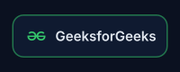</a>
  <a href="https://leetcode.com/u/Sandeep_Raj4678/">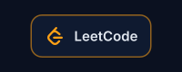</a>
  

 


  

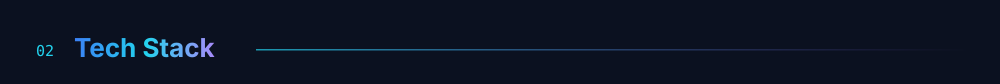
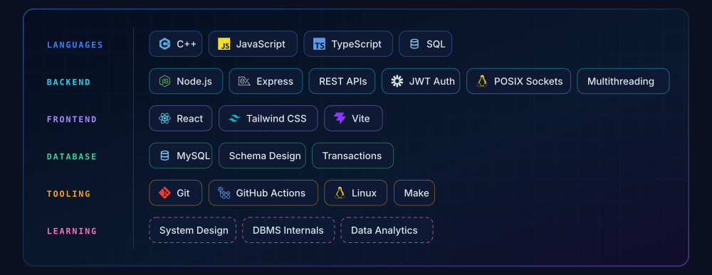

  

<a href="https://github.com/sandeepraj25/cpp-http-server">
  
</a>

  

<a href="https://github.com/sandeepraj25/TalentBridge">
  
</a>

  

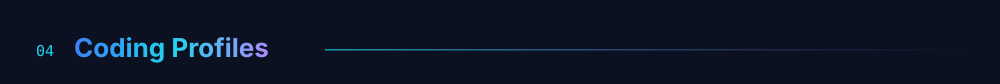

  <a href="https://www.geeksforgeeks.org/profile/sandeepraj25?tab=activity">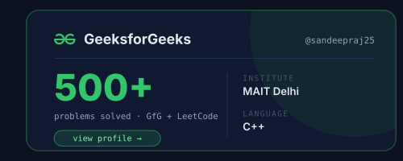</a>
  

 

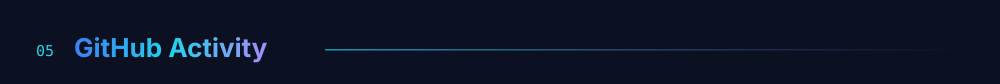

  

<picture>
  <source media="(prefers-color-scheme: dark)" srcset="https://raw.githubusercontent.com/sandeepraj25/sandeepraj25/output/snake-dark.svg" />
  <source media="(prefers-color-scheme: light)" srcset="https://raw.githubusercontent.com/sandeepraj25/sandeepraj25/output/snake-light.svg" />
  
</picture>

  

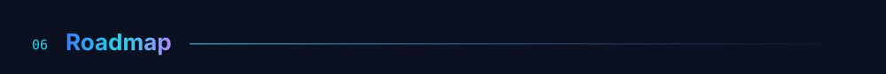

  

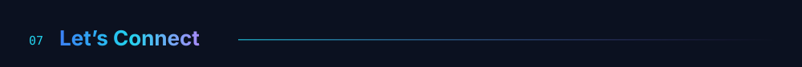

  
  <a href="https://github.com/sandeepraj25">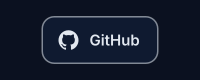</a>
  
  
  

 

